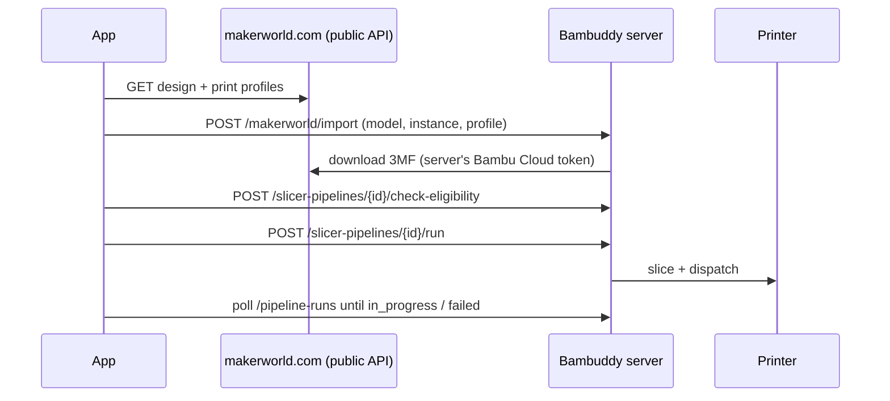

# MakerWorld catalog & one-tap print

A native MakerWorld browser lives in its own **Catalog** tab. Users can search and
browse models, inspect print profiles, keep favorites, and send a model to a printer
with a single tap. Bambuddy's server does the downloading, slicing and dispatching.

## What the user sees

| Screen | Contents |
| --- | --- |
| **Catalog tab** | Search field and feed chips: *Trending*, *Popular*, *Most liked*, *New*, *Favorites*. Two-column grid with cover, title, author, downloads and likes. Infinite scroll, pull to refresh. The search bar and chips slide away while you scroll down and come back as soon as you scroll up. |
| **Model screen** | Swipeable gallery, author, stats, an *Add to favorites* button (also a heart in the header), the list of **print profiles** (cover, print time, weight, material, filament colors, AMS badge), description, tags, licence and an *Open on MakerWorld* link. |
| **Print panel** (bottom of the model screen) | The selected **slicer pipeline** and a **Print** button with live status: downloading → checking printer → slicing → sending → *Sent to the printer!* |

## How one-tap print works



1. **Catalog data** comes straight from MakerWorld's public JSON API (the same one the
   website uses). No MakerWorld login is needed to browse.
2. **Import:** the selected profile is imported into the Bambuddy library with
   `POST /makerworld/import`. The server downloads it with its own Bambu Cloud token.
3. **Pre-flight:** `check-eligibility` checks the pipeline's printer and AMS filaments.
   If there are issues, the user sees them and can cancel or *Print anyway*. Blocking
   issues (no printer, printer not found) cannot be overridden.
4. **Run:** the [slicer pipeline](../src/screens/SlicerPipelinesScreen.tsx) slices the
   file with its presets and dispatches it to its target printer. The app polls the run
   and shows its status. Tapping the status opens *Pipeline runs*.

The chosen pipeline is remembered per server (AsyncStorage), so after the first choice
printing really is one tap.

### Server requirements

- Bambuddy server signed in to **Bambu Cloud** (*More → Profiles*). Otherwise the
  panel explains this and links to Profiles.
- At least one **slicer pipeline** with a target printer (*More → Slicer Pipelines*).
- User permissions: `makerworld:view`, `makerworld:import`, `pipelines:read`, `pipelines:run`.

## Favorites

Favorites are stored **on the device** (`@bambuddy_mobile:makerworld_favorites`).
MakerWorld's own collections need a MakerWorld login, and only the Bambuddy server
has that. A favorite keeps the card data (title, cover, author, counters), so the
*Favorites* feed works offline and can be searched locally.

## Code map

| File | Responsibility |
| --- | --- |
| [`src/api/makerworldCatalog.ts`](../src/api/makerworldCatalog.ts) | Read-only MakerWorld client: feeds, search, design details, formatting helpers |
| [`src/screens/CatalogScreen.tsx`](../src/screens/CatalogScreen.tsx) | Catalog tab: grid, feeds, search, collapsible header, favorites feed |
| [`src/screens/MakerWorldModelScreen.tsx`](../src/screens/MakerWorldModelScreen.tsx) | Model details, profile picker, favorites toggle |
| [`src/components/makerworld/OneTapPrintPanel.tsx`](../src/components/makerworld/OneTapPrintPanel.tsx) | Pipeline picker, import → pre-flight → run → status polling |
| [`src/store/makerworldFavoritesStore.ts`](../src/store/makerworldFavoritesStore.ts) | Persisted favorites (zustand + AsyncStorage) |
| [`src/utils/makerworldOneTap.ts`](../src/utils/makerworldOneTap.ts) | MakerWorld URL parsing, default-profile selection, pipeline helpers |
| [`src/screens/makerworldCatalogStrings.ts`](../src/screens/makerworldCatalogStrings.ts) | All UI strings of the feature |

MakerWorld endpoints used (unauthenticated):

| Purpose | Endpoint |
| --- | --- |
| Trending feed | `GET /api/v1/search-service/select/design/nav?navKey=Trending&offset=&limit=` |
| Search / sorted feeds | `GET /api/v1/search-service/select/design2?keyword=&orderBy=downloadCount\|likeCount&offset=&limit=` |
| Model details + profiles | `GET /api/v1/design-service/design/{id}` |

> [!NOTE]
> MakerWorld's `#profileId-N` URL hash carries the **instance id** (`instances[].id`),
> not `instances[].profileId`. Import requests send both.

## Translations

All strings go through the app's i18n layer and ship for every supported language.
To add or change a string:

1. Add it to `buildStrings()` in `makerworldCatalogStrings.ts` as
   `t('makerworldCatalog.<key>', { defaultValue: 'English text' })`.
2. Run `node scripts/update-native-translation-delta.js`. This writes the new English
   keys to `src/i18n/resources/en/delta-NNNN.json`.
3. Add the same keys with translations to `src/i18n/resources/<locale>/delta-NNNN.json`
   for every locale in `src/i18n/resources/manifest.json`.
4. Run `node scripts/generate-native-resources.js`, then
   `node scripts/validate-native-translations.js` and `npm test`.

## Tests

```bash
npx jest src/__tests__/api/makerworldCatalog.test.ts \
         src/__tests__/utils/makerworldOneTap.test.ts \
         src/__tests__/store/makerworldFavoritesStore.test.ts \
         src/__tests__/navigation
```
